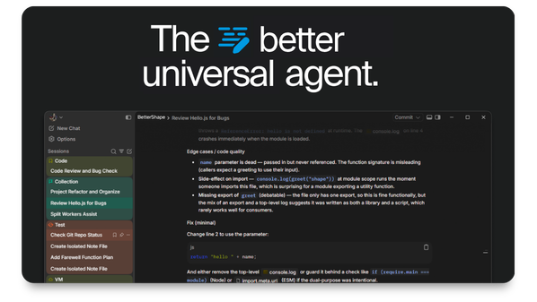
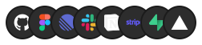

<p align="center">
  <a href="https://github.com/Owie6789/BetterShape">
    
  </a>
</p>

<p align="center">
  <a href="https://github.com/Owie6789/BetterShape/releases/latest"></a>
  <a href="https://github.com/Owie6789/BetterShape/actions/workflows/ci.yml"></a>
</p>

<p align="center">
  <a href="https://github.com/Owie6789/BetterShape">Website</a> ·
  <a href="https://github.com/Owie6789/BetterShape/tree/main/docs">Docs</a> ·
  <a href="https://github.com/Owie6789/BetterShape/releases">Download</a> ·
  <a href="https://discord.gg/MMCEDVZKYf">Discord</a>
</p>

BetterShape is a desktop agent, with cross-platform builds in development. You open a folder you work in. Chat sits beside the files, Git, and a terminal. You describe the change. BetterShape reads the project, answers in the thread, and edits files when you ask. BetterShape shows a diff for each edit. You commit when you want a commit.

It runs on your own model keys. There is no account, no plan, and no server of ours in the path.

If you're using version 1.0.0, 1.0.1, or 1.0.2, we recommend manually updating to 1.0.3.

## Work from the composer

Pick a mode before you send.

- **Code** edits files and can run commands.
- **Ask** reads the project and leaves files alone.
- **Plan** writes the approach and waits.
- **Visual** works on UI. Pair it with the in-app browser to see the screen.
- **Review** looks for a bug and proposes a small fix.

Type `@` to attach a file or folder. Type `/` to run a saved prompt.

[Agent](./docs/agent/overview.mdx)

## Models

Bring your own key. OpenAI, Anthropic, and Google are spoken natively, and any OpenAI-compatible endpoint (OpenRouter, xAI, DeepSeek, Groq, Mistral, LM Studio, Ollama) works through the same path. Add keys under Settings then Providers. Chat, embeddings, and search use your key and nothing else. `auto` follows the default model you pick.


[Models](./docs/get-started/models.mdx)

## Plugins

Connect GitHub, Figma, Linear, Slack, Notion, Stripe, Supabase, Vercel, and other accounts through your own Composio key. Add the key under Settings then Plugins, connect the accounts there, then ask in the thread: open a pull request, list Linear bugs, post a diff summary to Slack.



A plugin is a connected account. A tool that runs on your machine is [MCP](./docs/customize/mcp.mdx).

[Plugins](./docs/customize/plugins.mdx)

## Install

Use an installer actually published for your OS and architecture on [GitHub releases](https://github.com/better-Shape/app/releases), or a successful **Build Installers (Test)** workflow artifact. This draft configures Windows x86_64/ARM64, macOS Apple Silicon/Intel, and Linux x86_64/ARM64 packages, but those targets are not claimed as shipped support until their installers are produced and tested. See the [platform build matrix and verification requirements](./docs/developing/platform-support.mdx).

Stable is the tested channel. On nightly you get the newest installer, and that installer can break.

## Build from source

Node.js 22.13+ (or 24+), Rust, and [Tauri 2](https://v2.tauri.app/start/prerequisites/).

```bash
npm install
npm run tauri:dev
```

[CONTRIBUTING.md](./CONTRIBUTING.md) and [local development](./docs/developing/local-development.mdx).

```bash
npm run test          # Vitest
npm run test:rust     # Cargo
npm run test:all      # Both
```

TypeScript, React, Next.js App Router, Tauri 2, Rust.

## License

[Business Source License 1.1](./LICENSE). Code you send is under the same license.

Copyright © 2026 BetterShape. Based on Shape (BUSL-1.1).
