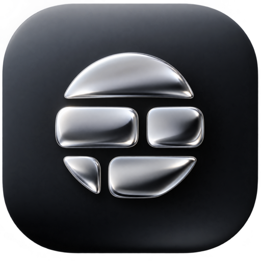

# BetterShape



A desktop agent for all your coding needs, plus so much more.

[Website](IN PROGRESS) · [Docs](IN PROGRESS) · [Download](IN PROGRESS) · [Discord](IN PROGRESS)


## Models

Suport for many models.


[Models](IN PROGRESS).

## Plugins

Connect over 20+ plugins the agent can use.


[Plugins](IN PROGRESS)

## Install

Windows 10 or 11, 64-bit. [Installer](https://useshape.org/download). Older builds: [Releases](https://github.com/Owie6789/BetterShape/releases).

Stable is the tested channel. Nightly ships latest and can break.

## Build from source

Node.js 18+, Rust, and [Tauri 2](https://v2.tauri.app/start/prerequisites/).

```bash
npm install
npm run tauri:dev
```

[CONTRIBUTING.md](./CONTRIBUTING.md) and [local development](/docs/developing/local-development).

```bash
npm run test          # Vitest
npm run test:rust     # Cargo
npm run test:all      # Both
```

TypeScript, React, Next.js App Router, Tauri 2, Rust.

## License

[Business Source License 1.1](./LICENSE). Code you send is under the same license.


